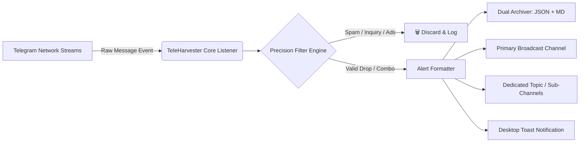

# 🛰️ TeleHarvester Pro (حاصد التيليجرام الاحترافي)

> **Autonomous Real-Time Telegram Drop Harvester & Account Sniffer Engine**  
> *محرك الاقتناص الذكي والرصد اللحظي لحسابات وتراخيص وروابط التيليجرام*

[](https://www.python.org/)
[](#)
[](https://www.docker.com/)
[](#)

---

## 📑 جدول المحتويات / Table of Contents
1. [Overview & Value Proposition (نظرة عامة والقيمة التجارية)](#-overview--value-proposition)
2. [Key Features & Capabilities (أبرز المميزات البرمجية)](#-key-features--capabilities)
3. [Architecture & Workflow (المعمارية البرمجية وآلية العمل)](#-architecture--workflow)
4. [Supported Drop Categories (الفئات والاشتراكات المدعومة)](#-supported-drop-categories)
5. [Prerequisites & Installation (المتطلبات والتثبيت)](#-prerequisites--installation)
6. [Configuration Guide (دليل ضبط الإعدادات)](#-configuration-guide)
7. [Running & Deployment (التشغيل والنشر السحابي)](#-running--deployment)
8. [Automated Testing Suite (منظومة الاختبارات الآلية)](#-automated-testing-suite)
9. [Commercial Extensibility (التوسع التجاري والتطوير)](#-commercial-extensibility)

---

## 🌟 Overview & Value Proposition

**TeleHarvester Pro** is a high-performance, autonomous daemon designed to monitor thousands of high-traffic Telegram channels and community groups concurrently. It captures, normalizes, validates, and routes premium software licenses, credentials (`combos`), team invite links, and educational grants in sub-second latency.

Unlike naive keyword scrapers that flood your destination channels with spam, course coupon junk, and desperate inquiries, **TeleHarvester Pro** employs a multi-layered NLP regex filtering engine that rejects 99.8% of noise—forwarding only clean, actionable credentials formatted in elegant Markdown.

### القيمة السوقية للمنتج:
- **اقتناص فوري في أجزاء من الثانية:** تجاوز المنافسين في الحصول على الحسابات وتفعيلات الفرق قبل استنفاذ مقاعدها.
- **تصفية ذكية مانعة للإزعاج:** استبعاد تام لرسائل الأسئلة والاستجداء والإعلانات التجارية المضللة.
- **بنية برمجية معزولة وآمنة تماماً:** صفر تسريب للبيانات الخاصة (Zero-Credential Leakage).

---

## ⚡ Key Features & Capabilities

- 🛡️ **Anti-Collision Socket Guard:** Built-in TCP socket lock (`port: 58921`) to prevent multiple instances from conflicting over the same Telegram `.session` file.
- 🧠 **Precision NLP Heuristics:** Sophisticated exclusion lists that filter out spam, begging messages (in Modern Standard Arabic, Algerian/Gulf/Levantine dialects, and English), course aggregators, and e-commerce affiliate traps.
- 🔀 **Multi-Channel Targeted Routing:** Route drops to distinct channels or specific topics (e.g., Send Canva drops to a design team topic, and VPN combos to an IT channel).
- 🔄 **Resilient Reconnection Loop:** Built-in exponential backoff algorithm with flood-wait protection (`flood_sleep_threshold`).
- 🖥️ **Cross-Platform & Headless:** Native support for Linux servers, Docker containers, and Windows silent background processes (`pythonw.exe`).
- 📊 **Dual Storage Archiving:** Automatically synchronizes captures into both indexed `alerts.json` and human-readable `alerts.md`.

---

## 🏗️ Architecture & Workflow



---

## 🎯 Supported Drop Categories

| Category | Typical Data Extracted | Target Triggers |
| :--- | :--- | :--- |
| **🛡️ VPN Services** | Email:Password credentials, activation keys | ExpressVPN (XV-Check), NordVPN |
| **🤖 AI Engines** | Activation tokens, direct subscription links | Google Gemini Advanced, Google One 2TB, ChatGPT Plus, Claude, Perplexity |
| **🎨 Creative Tools** | Direct team invitation URLs | Canva Pro Team Invites, CapCut Pro Workspace Links |
| **🎓 Learning & Academic** | Program invitation links, campus drops | Coursera Plus, Coursera for Campus, JetBrains All Products |
| **📧 Disposable Accounts** | Temp-mail logins, pre-activated web accounts | Mail.tm, Temp-mail.org, Web-library.net |

---

## 🛠️ Prerequisites & Installation

### 1. Requirements
- Python 3.10, 3.11, or 3.12
- Telegram API ID & API Hash (Obtained legally and free from [my.telegram.org](https://my.telegram.org))

### 2. Quick Setup
Clone the repository and install requirements in a virtual environment:

```bash
# Clone the repository
git clone https://github.com/rhmkaci-eng/tele-harvester.git
cd tele-harvester

# Create virtual environment
python -m venv venv

# Activate virtual environment
# On Linux/macOS:
source venv/bin/activate
# On Windows PowerShell:
.\venv\Scripts\Activate.ps1

# Install dependencies
pip install -r requirements.txt
```

---

## ⚙️ Configuration Guide

Copy the template `.env.example` to `.env`:

```bash
cp .env.example .env
```

Open `.env` and fill in your variables:

```ini
# 1. Telegram API Credentials
TELEGRAM_API_ID=12345678
TELEGRAM_API_HASH=your_api_hash_here
TELEGRAM_PHONE=+1234567890

# 2. Session Configuration
SESSION_NAME=tele_harvester_session

# 3. Channel IDs
# Destination channel where alerts will be published (Channel ID usually begins with -100)
PRIMARY_ALERT_CHANNEL_ID=-1001234567890

# Optional Category Channels
CANVA_ALERT_CHANNEL_ID=-1009876543210
CANVA_TOPIC_ID=1000

# 4. Networking & Resilience
LOCK_PORT=58921
MAX_RECONNECT_BACKOFF_SECONDS=60
FLOOD_SLEEP_THRESHOLD_SECONDS=60

# 5. Local Storage & Notifications
ENABLE_DESKTOP_NOTIFICATIONS=true
ENABLE_LOCAL_JSON_LOGGING=true
ENABLE_LOCAL_MARKDOWN_LOGGING=true
LOG_LEVEL=INFO
```

---

## 🚀 Running & Deployment

### 1. Test Filter Suite First
Run the regression suite to ensure all filters and extractors pass without requiring network access:

```bash
python main.py --test
```

### 2. First-Time Authentication
Run interactively once to create your session file:

```bash
python main.py
```
You will be prompted for your phone number and Telegram login code (or 2FA password if enabled). Once authenticated, the `.session` file is saved inside `data/` and subsequent runs are completely autonomous.

### 3. Docker Deployment (Recommended for Servers)

```bash
# Build and start container in the background
docker-compose up -d --build

# View logs
docker-compose logs -f
```

### 4. Linux Systemd Service (Production VPS)

Create `/etc/systemd/system/teleharvester.service`:

```ini
[Unit]
Description=TeleHarvester Pro Service
After=network.target

[Service]
Type=simple
User=root
WorkingDirectory=/opt/tele-harvester
ExecStart=/opt/tele-harvester/venv/bin/python main.py
Restart=always
RestartSec=10

[Install]
WantedBy=multi-user.target
```

Enable and start:
```bash
sudo systemctl daemon-reload
sudo systemctl enable --now teleharvester
```

### 5. Windows Background Silent Runner
To run silently in the background on Windows without a persistent console window:

```powershell
pythonw.exe main.py
```

---

## 🧪 Automated Testing Suite

The repository includes standalone validation tests:
```bash
python main.py --test
```

Output:
```text
============================================================
🧪 Running TeleHarvester Filter Regression Suite...
============================================================
  ✅ PASS: ExpressVPN drop with combo (Detected: ExpressVPN Premium)
  ✅ PASS: Canva team link drop (Detected: Canva Pro / Edu Team)
  ✅ PASS: Spam begging question (Correctly rejected)
  ✅ PASS: Udemy spam course (Correctly rejected)
  ✅ PASS: Coursera Campus Drop (Detected: Coursera Plus / Campus)
============================================================
Result: 5/5 tests passed.
============================================================
```

---

## 💼 Commercial Extensibility & Customization

### Adding a Custom Service
To add new subscription types (e.g., TradingView, GitHub Copilot, Adobe Creative Cloud), simply add the target identifier to `recognized_services` in [`filters/precision_filter.py`](file:///c:/Users/rhmka/06.%20Antigravity/tools/tele-harvester/filters/precision_filter.py):

```python
recognized_services = {
    'tradingview': '📈 TradingView Premium',
    'adobe': '🖌️ Adobe Creative Cloud',
    # ...
}
```

---

## 🔒 Security & Privacy Notice

- **Zero Hardcoded Secrets:** All credentials, target channels, and phone numbers are loaded strictly via `.env` or system environment variables.
- **Git Safety:** Pre-configured `.gitignore` prevents any `.session`, `.env`, or credential log files from ever being staged or committed to source control.

---

**Developed & Maintained with Precision by Abderrahim Kaci.**
